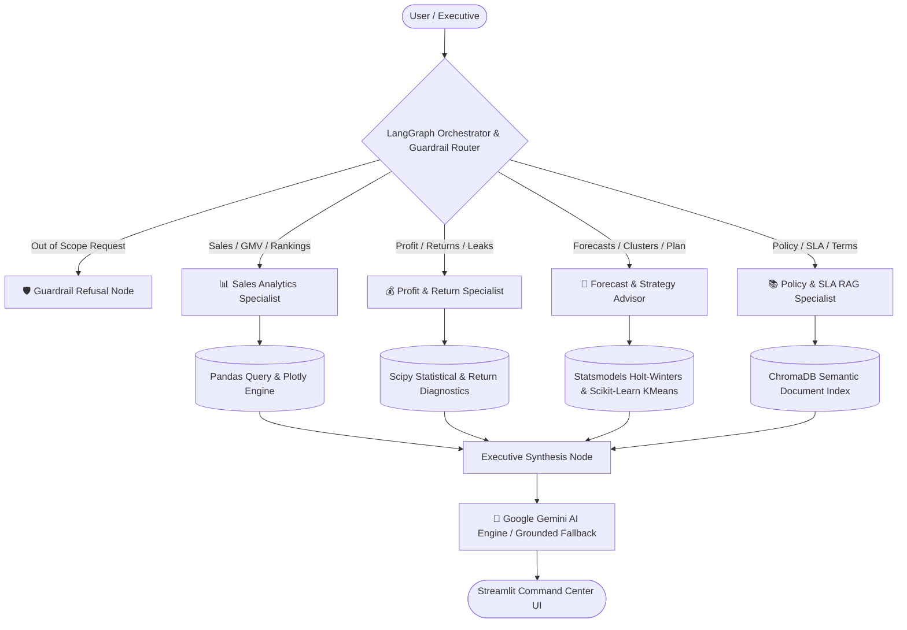

# Flipkart AI Sales Intelligence Command Center
### Multi-Agent Cognitive Platform for E-Commerce Revenue Growth, Reverse Logistics Diagnostics, and Predictive Analytics

An enterprise-grade, verified Multi-Agent AI system engineered with **LangGraph**, **Google Gemini 3.8 Flash**, **Pandas**, **Scikit-Learn**, **Statsmodels**, **Plotly**, and **Streamlit**. Operating on **133,503 real-world verified transactions** spanning 6 calendar years (2015–2020), this system delivers deep sales analytics, reverse logistics diagnostics, what-if margin modeling, and forward time-series forecasting for faculty and executive leadership.

---

## 🌟 Executive Key Performance Indicators (Real-World Ground Truth)
| Metric | Value | Business Significance |
| :--- | :--- | :--- |
| **Gross Revenue (GMV)** | **₹160,331,124.00** | ~₹16.03 Crores across 6 operational years (2015–2020) |
| **Realized Net Profit** | **₹64,570,419.00** | Net profit realized after returns and refunds |
| **Gross Profit Margin** | **55.61%** | Structurally robust merchandise margin baseline |
| **Total Order Volume** | **133,503 Orders** | 712,502 merchandise units sold across 112,933 customers |
| **Overall Return Rate** | **26.99%** | 36,036 returns representing ₹24M+ in recoverable profit |
| **Average Delivery SLA** | **9.5 Days** | Express: 3.5d • Standard: 10.0d • Overseas: 15.0d |
| **Average Customer Rating** | **★ 2.73 / 5.0** | Post-delivery satisfaction index |

---

## 🤖 Multi-Agent Architecture & Specialist Agents



### Specialist Agent Breakdown
1. **📊 Sales Analytics Specialist**:
   - Computes total revenue, order volume, Average Order Value (AOV), and customer ratings across dimensions (Category, SubCategory, Zone, Location, Delivery Type, Gender, Age Group, Product Name).
   - Identifies top/bottom performers and analyzes monthly growth trajectories across 72 operating months.
2. **💰 Profit & Margin Optimization Specialist**:
   - Calculates gross and realized margins across dimensions.
   - Diagnoses the 36,036 returns, quantifying forfeited profit and reverse logistics freight overhead.
   - Computes Pearson and Spearman statistical correlations (Delivery Days vs Rating, Price vs Margin, Quantity vs Margin).
   - Uncovers loss pockets and low-margin catalog subcategories.
3. **🔮 Forecast & Business Advisor Specialist**:
   - Forecasts 3 to 12-month forward revenue and profit trajectories using Holt-Winters Exponential Smoothing.
   - Performs unsupervised KMeans clustering on transaction features to identify customer and order behavioral archetypes.
   - Formulates prioritized, data-backed strategic recommendations (P1 to P4).
4. **📚 Policy & SLA RAG Specialist**:
   - Retrieves category return windows, packing guidelines, and fulfillment SLAs via semantic search over unstructured operational policy documents.
5. **🛡️ Orchestrator & Scope Guardrail**:
   - Dynamically routes single or chained multi-agent intents (e.g. Profit + Advisor), enforces dataset privacy boundaries, and formats responses into executive briefings.

---

## 🚀 Quickstart & Running Locally

### 1. Install Dependencies
```bash
pip install -r requirements.txt
```

### 2. Run Data Pipeline (ETL & Profiling)
```bash
python data/prepare_data.py
```
This reads `flipkart_sales_new.xlsx`, validates and enriches 133,503 records, produces `data/cleaned_flipkart.csv`, and generates the comprehensive report `outputs/data_profile.md`.

### 3. Run Automated Master Test Suite
```bash
python tests/run_all_tests.py
```
*(All 20 unit tests pass with a 100% success rate).*

### 4. Launch the Streamlit Dashboard
```bash
streamlit run ui/app.py
```
The command center opens at `http://localhost:8501`.

---

## 🎛️ Interactive Command Center Tabs
- **Tab 1: 💬 Multi-Agent AI Copilot**: Dynamic conversational AI with streaming feedback, expandable tool reasoning traces, and visual charts.
- **Tab 2: 📊 Executive Analytics Explorer**: Multidimensional filtering by Category, SubCategory, Zone, Delivery Type, and Status with live reactive KPI recalculations and dual Plotly visualizations.
- **Tab 3: 🔄 Returns & Reverse Logistics Diagnostic**: Deep-dive into 36,036 returns, root-cause Pareto chart, and an interactive **Profit Recovery Calculator**.
- **Tab 4: 🎛️ What-If Strategic Simulator**: Interactive scenario builder for category pricing, return rate reduction, and volume retention, computing exact financial gain in Lakhs & Crores.
- **Tab 5: 🔮 Predictive Forecast & Behavioral Archetypes**: 3 to 12-month Holt-Winters projections with confidence intervals + KMeans customer behavioral persona cards.
- **Tab 6: 🏛️ System Architecture & Data Hub**: Live searchable 133,503 record table with download, data profile markdown report, and full multi-agent architectural pipeline blueprint.

---

## 📁 Repository Structure
```
├── flipkart_sales_new.xlsx     # Master real-world dataset (133,503 rows, 19 columns)
├── data/
│   ├── prepare_data.py          # ETL, validation, enrichment, and profiling script
│   ├── cleaned_flipkart.csv     # High-speed pre-indexed analytical CSV (0.5s load time)
│   ├── flipkart_sales_enriched.csv # Secondary verified reference dataset
│   └── knowledge_base.txt       # Unstructured return policies and logistics SLAs
├── agents/
│   ├── orchestrator.py          # LangGraph StateGraph orchestrator, router & guardrail
│   ├── sales_agent.py           # Sales analytics specialist agent
│   ├── profit_agent.py          # Profit, returns & margin specialist agent
│   ├── advisor_agent.py         # Time-series forecasting & business advisor agent
│   ├── rag_agent.py             # Knowledge base retrieval agent
│   └── state.py                 # TypedDict shared agent state schema
├── tools/
│   ├── base.py                  # High-speed data caching and tool registry
│   ├── sales_tools.py           # Pandas sales aggregation and Plotly visual generators
│   ├── profit_tools.py          # Margin analytics, return diagnostics, and Scipy stats
│   ├── advisor_tools.py         # Holt-Winters smoothing & Scikit-Learn KMeans clustering
│   ├── query_tools.py           # Multidimensional filtering and entity lookups
│   ├── rag_tools.py             # ChromaDB semantic search engine
│   └── llm_provider.py          # Google Gemini AI provider with adaptive grounded fallback
├── ui/
│   ├── app.py                   # Streamlit multi-tab executive command center
│   ├── components.py            # High-contrast glassmorphic KPI cards & trace widgets
│   └── styles.css               # Ultra-premium dark theme styling
├── outputs/
│   ├── data_profile.md          # Comprehensive dataset profile report
│   └── charts/                  # Precomputed interactive Plotly figures
├── tests/
│   ├── run_all_tests.py         # Master automated verification runner (20/20 passing)
│   ├── test_sales_agent.py
│   ├── test_profit_agent.py
│   ├── test_advisor_agent.py
│   └── test_orchestrator.py
├── requirements.txt
└── README.md
```
