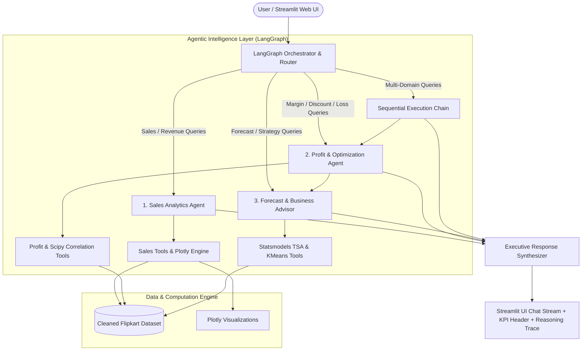

# Flipkart Sales Intelligence System

An enterprise-grade, runnable Multi-Agent AI system built with **LangGraph**, **Google Gemini**, **Pandas**, **Scikit-Learn**, **Statsmodels**, **Plotly**, and **Streamlit** to deliver deep sales intelligence, discount optimization, and predictive analytics for e-commerce executives.

---

## 🌟 Architecture & Workflow

The system utilizes a modular multi-agent architecture where an **Orchestrator** dynamically classifies user intent, dispatches tasks to specialist agents, tracks tool execution traces, and synthesizes consolidated executive briefings.



---

## 🤖 Specialist Agents

| Specialist Agent | Core Responsibilities | Computational Tools |
| :--- | :--- | :--- |
| **1. Sales Analytics Agent** | Computes exact total revenue, order volume, Average Order Value (AOV), and customer ratings across dimensions (Category, Product, Region, Customer Segment, Payment Method, Month). Ranks top and bottom performers. | `get_kpi_summary`, `query_sales_by_dimension`, `get_top_bottom_products`, `get_monthly_sales_trend`, `generate_sales_chart` |
| **2. Profit & Discount Optimization Agent** | Analyzes profit margins across dimensions, evaluates discount elasticity across Discount Bands (`5-10%`, `11-20%`, `21-30%`), computes Pearson & Spearman statistical correlations, and pinpoints loss-making pockets. | `analyze_profit_margins`, `analyze_discount_impact`, `compute_correlations`, `identify_loss_pockets`, `payment_method_analysis`, `generate_profit_chart` |
| **3. Forecast & Business Advisor Agent** | Projects 3-month forward revenue and profit trajectories using Holt-Winters Exponential Smoothing (with explicit confidence bounds), segments order archetypes via unsupervised KMeans clustering, and formulates prioritized recommendations. | `forecast_sales_and_profit`, `perform_kmeans_clustering`, `generate_strategic_recommendations` |
| **4. Orchestrator & Guardrail Node** | Routes user queries, handles multi-agent handoffs (e.g. Profit $\rightarrow$ Advisor), synthesizes executive summaries, and gracefully enforces scope boundaries. | `route_query`, `check_out_of_scope`, `refusal_node`, `response_synthesizer_node` |

---

## 🚀 Quickstart & Setup

### 1. Prerequisites
- Python 3.11 or higher installed on your system.

### 2. Clone & Install Dependencies
```bash
# Navigate to the project directory
cd "d:/Agentic AI project"

# Install required dependencies
pip install -r requirements.txt
```

### 3. Data Preparation & Verification
Generate and enrich the verified 1,000-row synthetic dataset:
```bash
python data/prepare_data.py
```
This generates:
- `data/flipkart_sales_enriched.csv` (1,000 rows x 15 columns)
- `data/cleaned_flipkart.csv` (Derived columns: `Profit Margin %`, `Year-Month`, `Discount Band`)
- `outputs/data_profile.md` (Comprehensive data summary and statistics)

### 4. Run Automated Test Suite
Verify that all mathematical and agent behaviors match Pandas ground truth:
```bash
python tests/run_all_tests.py
```
*(All 20 unit tests should pass with 100% success rate).*

### 5. Launch the Streamlit Web Application
```bash
streamlit run ui/app.py
```
The modern dark-mode dashboard will open automatically in your browser at `http://localhost:8501`.

---

## 🔑 LLM Configuration & Adding Your Gemini API Key

The system is configured by default in **Mock Mode** (`LLM_MODE=mock`), which executes deterministic routing, statistical tool calling, and structured templates without requiring an API key.

### How to Add Your Gemini API Key:
1. Open the `.env` file in the project root:
   ```env
   # Set LLM_MODE to 'gemini'
   LLM_MODE=gemini

   # Paste your Gemini API key from Google AI Studio (https://aistudio.google.com/)
   GEMINI_API_KEY=your_actual_gemini_api_key_here

   # Choose model (default: gemini-2.5-flash)
   GEMINI_MODEL=gemini-2.5-flash
   ```
2. Save the `.env` file and restart the Streamlit app.
3. The system will automatically detect the key and switch to live Gemini AI mode.

---

## 📊 Dataset Facts & Scope Boundaries

### Verified Dataset Properties:
- **Rows:** 1,000 verified transactions.
- **Columns (15 + 3 derived):** `Order ID`, `Product Name` (25 unique), `Category` (5: Electronics, Books, Home & Kitchen, Beauty, Clothing), `Price (INR)`, `Quantity Sold`, `Total Sales (INR)`, `Order Date` (`2024-02-12` to `2025-02-09`), `Payment Method`, `Customer Rating` (1.0-5.0), `Month`, `Year`, `Profit (INR)`, `Discount %` (5-30%), `Customer Segment` (`Retail`, `Online`, `Wholesale`), `Region` (`North`, `South`, `East`, `West`).
- **Derived Features:** `Profit Margin %`, `Year-Month`, `Discount Band`.

### Known Limitations:
1. **Synthetic Price Variation:** In this dataset, unit prices vary for the same product name across transactions to simulate market price volatility.
2. **Time Horizon (~12 Months):** The dataset spans Feb 12, 2024 to Feb 09, 2025. Calendar year 2025 contains only ~1 month of data. Forecasting models explicitly surface confidence bounds and state uncertainty regarding long-term annual seasonality.
3. **Out-of-Scope Data:** The dataset contains **NO review text**, **NO product descriptions**, and **NO customer PII** (names, addresses, IDs). The system explicitly rejects questions regarding review sentiment or individual customer identities.

---

## 🧪 Testing Summary

The test suite in `/tests` includes 20 unit tests across 4 suites:
- `tests/test_sales_agent.py`: 5 tests verifying KPIs, category sales, top products, and monthly trends against Pandas direct sums.
- `tests/test_profit_agent.py`: 5 tests verifying profit margins, discount bands, Scipy Pearson correlations, and loss pocket detection.
- `tests/test_advisor_agent.py`: 5 tests verifying Holt-Winters forecasts, uncertainty disclosures, KMeans cluster counts, and strategic recommendations.
- `tests/test_orchestrator.py`: 5 tests verifying router intent classification, multi-agent sequential chaining (Profit $\rightarrow$ Advisor), out-of-scope refusal handling, and execution tracing.

---

## 🔮 Future Work & Enhancements
- **Multi-Year Seasonality:** Integrate multi-year transaction streams with Prophet or SARIMAX to model annual festival peaks (Diwali Big Billion Days).
- **Automated Alerting:** Set threshold-based cron alerts for margin erosion spikes when discount rates exceed 25%.
- **Live Database Connectors:** Support direct PostgreSQL / Snowflake / BigQuery connectors for real-time order stream ingestion.
